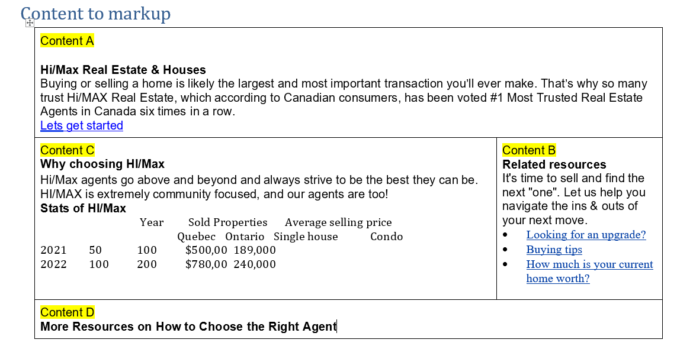

# CST8914 - Lab 6

## Section C

Professor, I tried to match the table layout from the Word document as closely as possible without changing the CSS. 
I used `aria-hidden="true"` for empty cells and `id` and `headers` attributes to improve screen reader accessibility.

